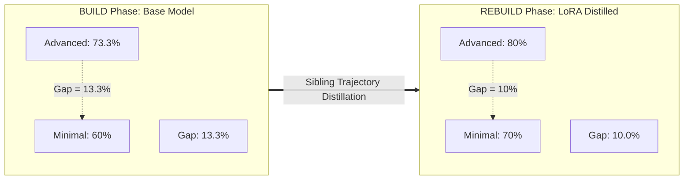

# HELIX Closed-Loop Evaluation Report: BUILD ($\Theta_0$) vs REBUILD ($\Theta_1$)

> **Live re-run, 2026-11-12 (supersedes the October 2026 numbers).** Every
> number in this report now comes from a fully live re-run executed
> 2026-11-12: BUILD 40/40 live on the base model, retraining on live-only
> data (run `20261112T041836`), REBUILD 40/40 live on the new adapter, and
> held-out evaluation 80/80 live (both models, 10 fresh tasks). All 160
> live traces carry `mode: live` with non-empty transcripts, and all 160
> `passed` flags were independently re-verified by re-running the sandbox
> tests (0 mismatches). The October 2026 numbers this replaces were based
> on a BUILD baseline of 9 live + 31 dry-run mock traces; that history and
> the audit behind it are preserved in
> [`PROVENANCE_AUDIT.md`](PROVENANCE_AUDIT.md). Held-out results are in §6
> and are reported separately from training-task numbers throughout.

## 1. Executive Summary

This report documents the empirical findings from the end-to-end execution of the **HELIX Closed-Loop Pipeline** (Build $\rightarrow$ Update $\rightarrow$ Rebuild) across 10 benchmark algorithmic problems evaluating 4 distinct agentic harnesses:
1. **Minimal** (Zero-Scaffolding / Direct 1-Shot)
2. **Pi Mono** (Single-Agent Baseline with iterative test feedback)
3. **Hermes Agent** (Session-Oriented with structured context)
4. **OpenCode** (Elite Autonomous Agent with rigorous 4-stage workflow)

### Key Finding: Small Training-Task Gain, Within Noise; Held-Out Set Saturates
> [!IMPORTANT]
> **Hypothesis**: *A zero-scaffolding / minimal harness achieves dramatic performance gains once the underlying model internalizes reasoning and tool-calling discipline distilled from complex harnesses.*
>
> **Observed result (training tasks only)**: The **Minimal Harness Pass@1 moved from 60.0% to 70.0% (+10.0 pp)** in a pure single-step format ($\text{avg\_steps} = 1.00$). Overall the LoRA model passed **31/40** vs the base model's **28/40** (+3 traces). The **Harness Gap** (advanced average minus Minimal) moved from **13.3 pp down to 10.0 pp**.
>
> **Read with care**: with n=10 tasks per harness, one task is 10 pp, and the flip pattern is consistent with sampling noise rather than learning: OpenCode gained the two tasks (lcb_002, lcb_003) that had *zero* passing traces in BUILD and therefore never entered training, while losing lcb_009, which *was* in the DPO training data. Training was 3 SFT steps on 8 records + 3 DPO steps on 2 pairs, with near-flat losses. On the held-out set (§6) both models solve essentially everything attempted (base 39/39 valid attempts, LoRA 40/40), so the held-out set as written cannot discriminate between them and **does not demonstrate generalisation**. The hypothesis is **not validated** by this run; a harder held-out set and more training data would be needed to test it.

---

## 2. LoRA Synchronization & Deployment

- **Base Model**: `Qwen/Qwen2.5-Coder-7B-Instruct`
- **Adapter**: LoRA weights trained via SFT + DPO from live-only sibling trajectories (`r=16`, `lora_alpha=32`, dropout 0.05, seed 42). Training run `20261112T041836-c2fce935` (Modal A100, Unsloth QLoRA): 8 SFT records / 3 steps (loss 1.0297 → 0.9474), 2 DPO pairs / 3 steps (loss 0.6931 → 0.6829). Full metadata, data hashes and loss history in `data/training_runs/20261112T041836-c2fce935/`; the training gate refused any data without a matching live-only provenance manifest. The previous adapter (Nov 4 run, 15 SFT / 10 DPO) was backed up in the volume as `helix-lora-final-backup-20261104` before being overwritten.
- **vLLM Engine Configuration**:
  - Hosted on Modal.com A10G GPU (`01_modal_vllm.py`).
  - Flag `--max-lora-rank 64` configured to avoid rank cutoff.
  - vLLM multi-LoRA alias: `helix-lora=/adapters/helix-lora-final`.
  - Routing is by the request's model id (base id → base weights, `helix-lora` → adapter). A previous proxy rule that silently rewrote base-model requests to the adapter was removed on 2026-11-12 (see the `PROVENANCE_AUDIT.md` addendum); it was not present in the October BUILD server, so the 9 originally-live traces were unaffected.
  - Health check confirmation: `{"status": "ok", "lora_enabled": true, "adapter": "helix-lora"}`.

---

## 3. Quantitative Comparison: BUILD vs REBUILD

Training tasks only (the same 10 tasks the adapter trained on). n=10 per harness; one task = 10 pp.

| Harness | Base Pass@1 ($\Theta_0$) | LoRA Pass@1 ($\Theta_1$) | Pass Rate $\Delta$ | Base Steps | LoRA Steps | Steps $\Delta$ | Base Latency | LoRA Latency |
| :--- | :---: | :---: | :---: | :---: | :---: | :---: | :---: | :---: |
| **Minimal** *(Zero-Scaffolding)* | **60.0%** (6/10) | **70.0%** (7/10) | **+10.0 pp** | 1.00 | 1.00 | 0.00 | 17.20s | 27.04s |
| **Pi Mono** *(Baseline)* | 70.0% (7/10) | 80.0% (8/10) | +10.0 pp | 2.30 | 1.80 | -0.50 | 49.41s | 61.90s |
| **Hermes Agent** *(Session)* | 70.0% (7/10) | 70.0% (7/10) | 0.0 pp | 2.20 | 2.30 | +0.10 | 47.46s | 74.58s |
| **OpenCode** *(Complex Scaffolding)* | 80.0% (8/10) | 90.0% (9/10) | +10.0 pp | 2.10 | 2.20 | +0.10 | 27.75s | 28.74s |

---

## 4. Harness Gap Reduction Analysis

The **Harness Gap** measures how much a system relies on external prompt engineering and multi-turn execution loops versus raw model capability:

$$\text{Harness Gap} = \text{Pass@1}(\text{Advanced Scaffolding}) - \text{Pass@1}(\text{Minimal})$$

- **BUILD Phase ($\Theta_0$)**:
  - Advanced average: $73.3\%$
  - Minimal: $60.0\%$
  - **Initial Harness Gap**: $73.3\% - 60.0\% = \mathbf{13.3\%}$
- **REBUILD Phase ($\Theta_1$)**:
  - Advanced average: $80.0\%$
  - Minimal: $70.0\%$
  - **Final Harness Gap**: $80.0\% - 70.0\% = \mathbf{10.0\%}$
- **Net Gap Reduction**:
  $$\Delta_{\text{gap}} = 13.3\% - 10.0\% = \mathbf{3.3\text{ percentage points}}$$

  This is one task's worth of movement on a 10-task set and is not distinguishable from sampling noise. The October report's 60 pp → 10 pp gap story was an artefact of the mock-contaminated BUILD baseline (Minimal 30% was measured mostly on dry-run traces) and is retracted.

---

## 5. Problem-by-Problem Trajectory Breakdown

| Task ID | Task Title | Difficulty | Minimal (BUILD $\rightarrow$ REBUILD) | Pi Mono (BUILD $\rightarrow$ REBUILD) | Hermes Agent (BUILD $\rightarrow$ REBUILD) | OpenCode (BUILD $\rightarrow$ REBUILD) |
| :--- | :--- | :---: | :---: | :---: | :---: | :---: |
| `lcb_001` | Two Sum with Indices | Easy | PASS $\rightarrow$ PASS | PASS $\rightarrow$ PASS | PASS $\rightarrow$ PASS | PASS $\rightarrow$ PASS |
| `lcb_002` | Valid Parentheses with Wildcard | Medium | FAIL $\rightarrow$ FAIL | FAIL $\rightarrow$ FAIL | FAIL $\rightarrow$ FAIL | FAIL $\rightarrow$ **PASS** |
| `lcb_003` | LRU Cache with Eviction Return | Medium | FAIL $\rightarrow$ FAIL | FAIL $\rightarrow$ FAIL | FAIL $\rightarrow$ FAIL | FAIL $\rightarrow$ **PASS** |
| `lcb_004` | Reverse a Linked List | Easy | PASS $\rightarrow$ PASS | PASS $\rightarrow$ PASS | PASS $\rightarrow$ PASS | PASS $\rightarrow$ PASS |
| `lcb_005` | Binary Search | Easy | PASS $\rightarrow$ PASS | PASS $\rightarrow$ PASS | PASS $\rightarrow$ PASS | PASS $\rightarrow$ PASS |
| `lcb_006` | Maximum Subarray Sum & Slice | Medium | PASS $\rightarrow$ PASS | PASS $\rightarrow$ PASS | PASS $\rightarrow$ PASS | PASS $\rightarrow$ PASS |
| `lcb_007` | Climbing Stairs (DP) | Easy | PASS $\rightarrow$ PASS | PASS $\rightarrow$ PASS | PASS $\rightarrow$ PASS | PASS $\rightarrow$ PASS |
| `lcb_008` | Merge Overlapping Intervals | Medium | FAIL $\rightarrow$ **PASS** | PASS $\rightarrow$ PASS | PASS $\rightarrow$ PASS | PASS $\rightarrow$ PASS |
| `lcb_009` | Word Break Sentences | Medium | FAIL $\rightarrow$ FAIL | FAIL $\rightarrow$ **PASS** | FAIL $\rightarrow$ FAIL | PASS $\rightarrow$ FAIL |
| `lcb_010` | Number of Islands (2D Grid) | Medium | PASS $\rightarrow$ PASS | PASS $\rightarrow$ PASS | PASS $\rightarrow$ PASS | PASS $\rightarrow$ PASS |

Flips: 4 gains (lcb_002 + lcb_003 OpenCode, lcb_008 Minimal, lcb_009 Pi Mono) and 1 loss (lcb_009 OpenCode), net +3/40. Note that lcb_002 and lcb_003 had no passing BUILD trace and therefore contributed no training data — their OpenCode gains cannot be training recall. Conversely lcb_009 *was* in the DPO data (chosen) and OpenCode still lost it. The pattern is what sampling noise looks like at this scale.

> **Retracted**: the October report's "Critical Breakthroughs" narrative (lcb_004, lcb_006, lcb_010 flipping in Minimal) described the mock-contaminated baseline. In the live re-run, all three tasks pass under Minimal in *both* phases — there was no breakthrough to explain.

---

## 6. Held-Out Evaluation (Fresh Tasks, Never Trained On)

Design: 10 fresh problems (`held_001`–`held_010`, 4 easy / 6 medium) in `data/heldout_problems.json`, disjoint by ID from the 10 training tasks, with reference solutions verified offline but never committed and never used for training. Both models ran all 40 harness/task combinations live (80 traces, all `mode: live` with transcripts). Filenames carry the model slug (`heldout_base_…`, `heldout_helix-lora_…`) so the two runs cannot overwrite each other.

| Harness | Base Pass@1 | LoRA Pass@1 | $\Delta$ |
| :--- | :---: | :---: | :---: |
| **Minimal** | 100% (10/10) | 100% (10/10) | 0 pp |
| **Pi Mono** | 90.0% (9/10) | 100% (10/10) | +10.0 pp |
| **Hermes Agent** | 100% (10/10) | 100% (10/10) | 0 pp |
| **OpenCode** | 100% (10/10) | 100% (10/10) | 0 pp |
| **Total** | **39/40** | **40/40** | +1 trace |

**The single base-model non-pass is an infrastructure error, not a capability failure**: `held_006` under Pi Mono returned HTTP 400 because the multi-turn transcript grew the prompt past the 4096-token context window (3073 input tokens + 1024 requested output tokens). Excluding that invalid attempt, the base model passed 39/39 valid attempts and the LoRA model 40/40. Per-task, every held-out task passed under every harness for both models except that one errored cell.

**Interpretation — ceiling effect.** The held-out set as written is too easy to discriminate between the models: the base model already solves essentially everything, so no gain (or loss) can be measured. This run establishes that the adapter does not *regress* on fresh tasks and that the held-out harness works end-to-end with no leakage — but it does **not** demonstrate generalisation. A discriminating held-out set needs harder problems (and/or stricter tests) where the base model scores well below ceiling.

---

## 7. Visualization

The comparison plot was regenerated from the 160 live Round 1 traces with
Wilson 95% intervals (script: `notebooks/round1_stats.py`; figure:
`data/rebuild_comparison_plot.svg`, PNG alongside it). The October plot
charting the mock-contaminated numbers is superseded; the tables above
remain authoritative. The wide, overlapping intervals are the point: at
n=10 per harness, a one-task delta cannot be distinguished from noise.

## 8. Supplementary statistics (Round 1, offline analysis)

Computed 2026-11-12 from the trace files only
(`notebooks/round1_stats.py` → `data/analysis_round1.json`); no new model
calls, no change to any Round 1 number above. All 160 `passed` flags were
re-verified a second time by re-running the sandbox tests: **0 mismatches**.

### 8.1 Portfolio union (tasks solved by at least one harness)

The paper's headline portfolio quantity is a post-hoc union (79/100 on
AtCoder). The same quantity here, per model on the 10 training tasks:

| Model | Union | Wilson 95% | Tasks solved by no harness |
| :--- | :---: | :---: | :--- |
| Base (BUILD) | 8/10 | 49.0%–94.3% | `lcb_002`, `lcb_003` |
| LoRA (REBUILD) | 10/10 | 72.2%–100% | — |

Held-out v1 union is 10/10 for both models. The union gain on training
tasks comes from the same two OpenCode flips discussed in §5 (tasks with
no training data); it is reported as a descriptive portfolio quantity,
not as evidence of learning.

### 8.2 Wilson 95% intervals for Pass@1

| Harness | BUILD | Wilson 95% | REBUILD | Wilson 95% |
| :--- | :---: | :---: | :---: | :---: |
| Minimal | 60.0% (6/10) | 31.3%–83.2% | 70.0% (7/10) | 39.7%–89.2% |
| Pi Mono | 70.0% (7/10) | 39.7%–89.2% | 80.0% (8/10) | 49.0%–94.3% |
| Hermes Agent | 70.0% (7/10) | 39.7%–89.2% | 70.0% (7/10) | 39.7%–89.2% |
| OpenCode | 80.0% (8/10) | 49.0%–94.3% | 90.0% (9/10) | 59.6%–98.2% |
| **Total** | **70.0% (28/40)** | **54.6%–81.9%** | **77.5% (31/40)** | **62.5%–87.7%** |

Held-out v1 totals: base 97.5% (39/40, Wilson 87.1%–99.6%), LoRA 100%
(40/40, Wilson 91.2%–100%). Every interval overlaps its counterpart.

### 8.3 McNemar tests on paired cells

Paired by (task, harness), 40 cells each. BUILD → REBUILD: 4 gains,
1 loss, 27 same-pass, 8 same-fail; exact two-sided p = **0.375**
(continuity-corrected χ² = 0.80). Held-out base → LoRA: 1 gain, 0 losses,
39 same-pass; exact p = **1.0**. Neither change is statistically
distinguishable from no change at this scale; the single held-out gain is
the infrastructure-error cell (§6), not a capability difference. These
tests formalise the §1 reading: the Round 1 gain is consistent with
sampling noise.

## 9. Round 2 (2026-11-12) — 20 training tasks, sampling, held-out v2

Round 2 re-ran the full loop on an expanded, disjoint training set with a
larger training dataset and a harder held-out set, under the design in
[`ROUND2_DESIGN.md`](ROUND2_DESIGN.md). Round 1 sections above are kept
verbatim; nothing in Round 1 was re-run. All Round 2 numbers below come
from `notebooks/round2_stats.py` → `data/analysis_round2.json` and the
training-run metadata; baseline cells only (temperature 0.0, sample 0)
for all rates, unions and McNemar tests.

### 9.1 What changed vs Round 1

- **Training set:** 20 tasks (`lcb_001`–`lcb_020`); the 10 new tasks
  (`lcb_011`–`lcb_020`) live in `data/train_extra_problems.json`.
  Reference solutions for all 25 new problems (train-extra + held-out v2)
  were verified offline 25/25 before any live run.
- **Sampling:** after the temp-0.0 BUILD2, 80 extra cells (minimal +
  opencode, temperature 0.7, n=2) were run for training extraction only;
  they never enter baseline comparisons. Sampling produced 63/80 passes
  and added the only SFT/DPO records for `lcb_003` and `lcb_013`.
- **Context fix:** `--max-model-len` 4096 → 8192 plus a prompt-truncation
  guard in `02_run_helix_eval.py`. Result: **0 prompt truncations and 0
  infrastructure-error traces in all 360 Round 2 traces** (Round 1 had 1
  HTTP 400 context-overflow cell).
- **Feedback-loop cap:** advanced harnesses capped at 4 steps (evidence:
  all 105 passing advanced Round 1 cells finished in ≤3 steps; every
  Round 1 cell reaching 6+ steps ended in HTTP 400). The cap applies
  uniformly to both models and all phases; recipe configs unchanged.
- **Run tags:** every Round 2 trace carries `run_tag`
  (`build2`/`rebuild2`/`heldout2`) in JSON and filename; no Round 1 file
  was overwritten (Round 1 checksums re-verified before the run).
- **Training data:** live-only extraction from 160 BUILD2 traces
  (80 baseline + 80 sampling) → **SFT 19, DPO 6** (Round 1: SFT 8,
  DPO 2). Provenance manifest: `run_tag_filter: [build2]`, 0 dry-run
  traces, leakage check clean (no held-out ID in any training record).
  `lcb_002` was never solved in any BUILD2 trace, so it has no training
  record. SFT hash `4f4d6ad8…`, DPO hash `a40fa5b1…`.
- **Training:** run `20261112T082610-f368cbfe`, same hyperparameters as
  Round 1 (r=16, alpha=32, lr 2e-4, DPO lr 5e-6, seed 42, epochs 3).
  SFT 9 steps, loss 1.00 → 0.49; DPO 3 steps, loss 0.693 → 0.660.
  The Round 1 adapter was backed up as
  `helix-lora-final-backup-20261112` before this adapter overwrote
  `helix-lora-final`. Endpoint redeployed and routing re-verified (both
  model IDs return their own id; `max_model_len` 8192).

### 9.2 BUILD2 vs REBUILD2 (20 tasks × 4 harnesses, temp 0.0)

| Harness | BUILD2 (base) | Wilson 95% | REBUILD2 (LoRA) | Wilson 95% |
| :--- | :---: | :---: | :---: | :---: |
| Minimal | 70.0% (14/20) | 48.1%–85.5% | 85.0% (17/20) | 64.0%–94.8% |
| Pi Mono | 75.0% (15/20) | 53.1%–88.8% | 80.0% (16/20) | 58.4%–91.9% |
| Hermes Agent | 70.0% (14/20) | 48.1%–85.5% | 75.0% (15/20) | 53.1%–88.8% |
| OpenCode | 85.0% (17/20) | 64.0%–94.8% | 90.0% (18/20) | 69.9%–97.2% |
| **Total** | **75.0% (60/80)** | **64.5%–83.2%** | **82.5% (66/80)** | **72.7%–89.3%** |

Paired McNemar (80 cells): **7 gains, 1 loss**, 59 same-pass, 13
same-fail; exact two-sided p = **0.0703** (continuity-corrected
χ² = 3.125). Gains: `lcb_002` pi-mono; `lcb_003` minimal + opencode;
`lcb_013` minimal + opencode; `lcb_017` hermes; `lcb_019` minimal.
The single loss is `lcb_009` opencode — a DPO chosen cell, which cuts
against a clean learning story. The `lcb_002` gain is on a task with no
training record at all. p = 0.07 is suggestive but not significant at
0.05; the pattern is more favourable than Round 1 (p = 0.375) but still
consistent with sampling noise at this scale.

Portfolio union: BUILD2 17/20 (unsolved `lcb_002`, `lcb_003`, `lcb_013`;
Wilson 64.0%–94.8%) → REBUILD2 19/20 (unsolved only `lcb_009`; Wilson
76.4%–99.1%). The union gain comes from the same flip cells above.

### 9.3 Held-out v2 (15 hard tasks × 4 harnesses × 2 models, temp 0.0)

Held-out v2 (`held2_001`–`held2_015`, `data/heldout2_problems.json`) is
disjoint from all training and from held-out v1, and was never used in
training. Base total 83.3% is below the 85% ceiling target set in the
design, so the set discriminates — unlike held-out v1 (97.5%/100%).

| Harness | Base | Wilson 95% | LoRA | Wilson 95% |
| :--- | :---: | :---: | :---: | :---: |
| Minimal | 80.0% (12/15) | 54.8%–93.0% | 86.7% (13/15) | 62.1%–96.3% |
| Pi Mono | 86.7% (13/15) | 62.1%–96.3% | 86.7% (13/15) | 62.1%–96.3% |
| Hermes Agent | 86.7% (13/15) | 62.1%–96.3% | 86.7% (13/15) | 62.1%–96.3% |
| OpenCode | 80.0% (12/15) | 54.8%–93.0% | 93.3% (14/15) | 70.2%–98.8% |
| **Total** | **83.3% (50/60)** | **72.0%–90.7%** | **88.3% (53/60)** | **77.8%–94.2%** |

Paired McNemar (60 cells): **5 gains, 2 losses**, 48 same-pass, 5
same-fail; exact two-sided p = **0.4531** (χ² = 0.571). Gains:
`held2_001` hermes, `held2_002` opencode, `held2_014` minimal/opencode/
pi-mono. Losses: `held2_008` pi-mono, `held2_014` hermes. Union is 14/15
for both models (unsolved: `held2_009` next permutation, 0/8 cells).
**No generalisation is demonstrated**: the +3 held-out delta is well
within noise (p = 0.45), and the same task (`held2_014`) flips both ways
across harnesses.

### 9.4 Verification and cost

- **Re-verification:** all 360 Round 2 `passed` flags re-verified by
  re-running the sandbox tests: **0 mismatches**. Trace counts: BUILD2
  160 (80 baseline + 80 sampling), REBUILD2 80, held-out v2 120.
  Total recorded live latency 9,266.7 s (baseline 7,729.7 s).
- **Figure:** `data/round2_comparison_plot.svg` (PNG alongside), Wilson
  error bars, from the same script.
- **GPU cost (estimate):** ≈ **$4.30** for Round 2 — recorded serving
  latency 10,279.7 s including the discarded uncapped attempt (~$3.14 at
  $1.10/hr A10G), training run ~$0.70 (A100), cold-start/idle overhead
  ~$0.50. Inside the $6 cap. Modal balance is not readable via CLI, so
  this is an estimate from recorded GPU time, not a billing statement.
- **Honest reading:** Round 2 improves the evidence base (2× training
  tasks, 3× DPO pairs, a discriminating held-out set, zero infra errors)
  but does not change the conclusion: the training-task gain (p = 0.07)
  is suggestive, the held-out gain (p = 0.45) is noise, and no claim of
  real learning or generalisation is warranted. The remaining gaps —
  emulated harnesses, hand-written tasks, one co-evolution round — are
  Group 3 work, not started.
