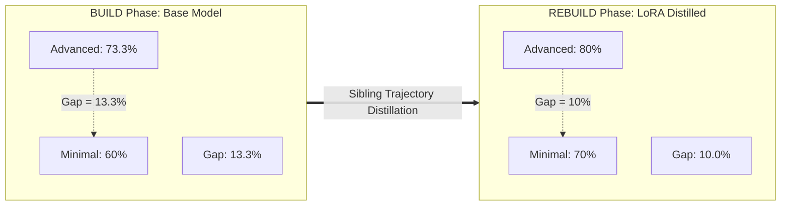

# HELIX Closed-Loop Evaluation Report: BUILD ($\Theta_0$) vs REBUILD ($\Theta_1$)

> **Live re-run, 2026-11-12 (supersedes the October 2026 numbers).** Every
> number in this report now comes from a fully live re-run executed
> 2026-11-12: BUILD 40/40 live on the base model, retraining on live-only
> data (run `20261112T041836`), REBUILD 40/40 live on the new adapter, and
> held-out evaluation 80/80 live (both models, 10 fresh tasks). All 160
> live traces carry `mode: live` with non-empty transcripts, and all 160
> `passed` flags were independently re-verified by re-running the sandbox
> tests (0 mismatches). The October 2026 numbers this replaces were based
> on a BUILD baseline of 9 live + 31 dry-run mock traces; that history and
> the audit behind it are preserved in
> [`PROVENANCE_AUDIT.md`](PROVENANCE_AUDIT.md). Held-out results are in §6
> and are reported separately from training-task numbers throughout.

## 1. Executive Summary

This report documents the empirical findings from the end-to-end execution of the **HELIX Closed-Loop Pipeline** (Build $\rightarrow$ Update $\rightarrow$ Rebuild) across 10 benchmark algorithmic problems evaluating 4 distinct agentic harnesses:
1. **Minimal** (Zero-Scaffolding / Direct 1-Shot)
2. **Pi Mono** (Single-Agent Baseline with iterative test feedback)
3. **Hermes Agent** (Session-Oriented with structured context)
4. **OpenCode** (Elite Autonomous Agent with rigorous 4-stage workflow)

### Key Finding: Small Training-Task Gain, Within Noise; Held-Out Set Saturates
> [!IMPORTANT]
> **Hypothesis**: *A zero-scaffolding / minimal harness achieves dramatic performance gains once the underlying model internalizes reasoning and tool-calling discipline distilled from complex harnesses.*
>
> **Observed result (training tasks only)**: The **Minimal Harness Pass@1 moved from 60.0% to 70.0% (+10.0 pp)** in a pure single-step format ($\text{avg\_steps} = 1.00$). Overall the LoRA model passed **31/40** vs the base model's **28/40** (+3 traces). The **Harness Gap** (advanced average minus Minimal) moved from **13.3 pp down to 10.0 pp**.
>
> **Read with care**: with n=10 tasks per harness, one task is 10 pp, and the flip pattern is consistent with sampling noise rather than learning: OpenCode gained the two tasks (lcb_002, lcb_003) that had *zero* passing traces in BUILD and therefore never entered training, while losing lcb_009, which *was* in the DPO training data. Training was 3 SFT steps on 8 records + 3 DPO steps on 2 pairs, with near-flat losses. On the held-out set (§6) both models solve essentially everything attempted (base 39/39 valid attempts, LoRA 40/40), so the held-out set as written cannot discriminate between them and **does not demonstrate generalisation**. The hypothesis is **not validated** by this run; a harder held-out set and more training data would be needed to test it.

---

## 2. LoRA Synchronization & Deployment

- **Base Model**: `Qwen/Qwen2.5-Coder-7B-Instruct`
- **Adapter**: LoRA weights trained via SFT + DPO from live-only sibling trajectories (`r=16`, `lora_alpha=32`, dropout 0.05, seed 42). Training run `20261112T041836-c2fce935` (Modal A100, Unsloth QLoRA): 8 SFT records / 3 steps (loss 1.0297 → 0.9474), 2 DPO pairs / 3 steps (loss 0.6931 → 0.6829). Full metadata, data hashes and loss history in `data/training_runs/20261112T041836-c2fce935/`; the training gate refused any data without a matching live-only provenance manifest. The previous adapter (Nov 4 run, 15 SFT / 10 DPO) was backed up in the volume as `helix-lora-final-backup-20261104` before being overwritten.
- **vLLM Engine Configuration**:
  - Hosted on Modal.com A10G GPU (`01_modal_vllm.py`).
  - Flag `--max-lora-rank 64` configured to avoid rank cutoff.
  - vLLM multi-LoRA alias: `helix-lora=/adapters/helix-lora-final`.
  - Routing is by the request's model id (base id → base weights, `helix-lora` → adapter). A previous proxy rule that silently rewrote base-model requests to the adapter was removed on 2026-11-12 (see the `PROVENANCE_AUDIT.md` addendum); it was not present in the October BUILD server, so the 9 originally-live traces were unaffected.
  - Health check confirmation: `{"status": "ok", "lora_enabled": true, "adapter": "helix-lora"}`.

---

## 3. Quantitative Comparison: BUILD vs REBUILD

Training tasks only (the same 10 tasks the adapter trained on). n=10 per harness; one task = 10 pp.

| Harness | Base Pass@1 ($\Theta_0$) | LoRA Pass@1 ($\Theta_1$) | Pass Rate $\Delta$ | Base Steps | LoRA Steps | Steps $\Delta$ | Base Latency | LoRA Latency |
| :--- | :---: | :---: | :---: | :---: | :---: | :---: | :---: | :---: |
| **Minimal** *(Zero-Scaffolding)* | **60.0%** (6/10) | **70.0%** (7/10) | **+10.0 pp** | 1.00 | 1.00 | 0.00 | 17.20s | 27.04s |
| **Pi Mono** *(Baseline)* | 70.0% (7/10) | 80.0% (8/10) | +10.0 pp | 2.30 | 1.80 | -0.50 | 49.41s | 61.90s |
| **Hermes Agent** *(Session)* | 70.0% (7/10) | 70.0% (7/10) | 0.0 pp | 2.20 | 2.30 | +0.10 | 47.46s | 74.58s |
| **OpenCode** *(Complex Scaffolding)* | 80.0% (8/10) | 90.0% (9/10) | +10.0 pp | 2.10 | 2.20 | +0.10 | 27.75s | 28.74s |

---

## 4. Harness Gap Reduction Analysis

The **Harness Gap** measures how much a system relies on external prompt engineering and multi-turn execution loops versus raw model capability:

$$\text{Harness Gap} = \text{Pass@1}(\text{Advanced Scaffolding}) - \text{Pass@1}(\text{Minimal})$$

- **BUILD Phase ($\Theta_0$)**:
  - Advanced average: $73.3\%$
  - Minimal: $60.0\%$
  - **Initial Harness Gap**: $73.3\% - 60.0\% = \mathbf{13.3\%}$
- **REBUILD Phase ($\Theta_1$)**:
  - Advanced average: $80.0\%$
  - Minimal: $70.0\%$
  - **Final Harness Gap**: $80.0\% - 70.0\% = \mathbf{10.0\%}$
- **Net Gap Reduction**:
  $$\Delta_{\text{gap}} = 13.3\% - 10.0\% = \mathbf{3.3\text{ percentage points}}$$

  This is one task's worth of movement on a 10-task set and is not distinguishable from sampling noise. The October report's 60 pp → 10 pp gap story was an artefact of the mock-contaminated BUILD baseline (Minimal 30% was measured mostly on dry-run traces) and is retracted.

---

## 5. Problem-by-Problem Trajectory Breakdown

| Task ID | Task Title | Difficulty | Minimal (BUILD $\rightarrow$ REBUILD) | Pi Mono (BUILD $\rightarrow$ REBUILD) | Hermes Agent (BUILD $\rightarrow$ REBUILD) | OpenCode (BUILD $\rightarrow$ REBUILD) |
| :--- | :--- | :---: | :---: | :---: | :---: | :---: |
| `lcb_001` | Two Sum with Indices | Easy | PASS $\rightarrow$ PASS | PASS $\rightarrow$ PASS | PASS $\rightarrow$ PASS | PASS $\rightarrow$ PASS |
| `lcb_002` | Valid Parentheses with Wildcard | Medium | FAIL $\rightarrow$ FAIL | FAIL $\rightarrow$ FAIL | FAIL $\rightarrow$ FAIL | FAIL $\rightarrow$ **PASS** |
| `lcb_003` | LRU Cache with Eviction Return | Medium | FAIL $\rightarrow$ FAIL | FAIL $\rightarrow$ FAIL | FAIL $\rightarrow$ FAIL | FAIL $\rightarrow$ **PASS** |
| `lcb_004` | Reverse a Linked List | Easy | PASS $\rightarrow$ PASS | PASS $\rightarrow$ PASS | PASS $\rightarrow$ PASS | PASS $\rightarrow$ PASS |
| `lcb_005` | Binary Search | Easy | PASS $\rightarrow$ PASS | PASS $\rightarrow$ PASS | PASS $\rightarrow$ PASS | PASS $\rightarrow$ PASS |
| `lcb_006` | Maximum Subarray Sum & Slice | Medium | PASS $\rightarrow$ PASS | PASS $\rightarrow$ PASS | PASS $\rightarrow$ PASS | PASS $\rightarrow$ PASS |
| `lcb_007` | Climbing Stairs (DP) | Easy | PASS $\rightarrow$ PASS | PASS $\rightarrow$ PASS | PASS $\rightarrow$ PASS | PASS $\rightarrow$ PASS |
| `lcb_008` | Merge Overlapping Intervals | Medium | FAIL $\rightarrow$ **PASS** | PASS $\rightarrow$ PASS | PASS $\rightarrow$ PASS | PASS $\rightarrow$ PASS |
| `lcb_009` | Word Break Sentences | Medium | FAIL $\rightarrow$ FAIL | FAIL $\rightarrow$ **PASS** | FAIL $\rightarrow$ FAIL | PASS $\rightarrow$ FAIL |
| `lcb_010` | Number of Islands (2D Grid) | Medium | PASS $\rightarrow$ PASS | PASS $\rightarrow$ PASS | PASS $\rightarrow$ PASS | PASS $\rightarrow$ PASS |

Flips: 4 gains (lcb_002 + lcb_003 OpenCode, lcb_008 Minimal, lcb_009 Pi Mono) and 1 loss (lcb_009 OpenCode), net +3/40. Note that lcb_002 and lcb_003 had no passing BUILD trace and therefore contributed no training data — their OpenCode gains cannot be training recall. Conversely lcb_009 *was* in the DPO data (chosen) and OpenCode still lost it. The pattern is what sampling noise looks like at this scale.

> **Retracted**: the October report's "Critical Breakthroughs" narrative (lcb_004, lcb_006, lcb_010 flipping in Minimal) described the mock-contaminated baseline. In the live re-run, all three tasks pass under Minimal in *both* phases — there was no breakthrough to explain.

---

## 6. Held-Out Evaluation (Fresh Tasks, Never Trained On)

Design: 10 fresh problems (`held_001`–`held_010`, 4 easy / 6 medium) in `data/heldout_problems.json`, disjoint by ID from the 10 training tasks, with reference solutions verified offline but never committed and never used for training. Both models ran all 40 harness/task combinations live (80 traces, all `mode: live` with transcripts). Filenames carry the model slug (`heldout_base_…`, `heldout_helix-lora_…`) so the two runs cannot overwrite each other.

| Harness | Base Pass@1 | LoRA Pass@1 | $\Delta$ |
| :--- | :---: | :---: | :---: |
| **Minimal** | 100% (10/10) | 100% (10/10) | 0 pp |
| **Pi Mono** | 90.0% (9/10) | 100% (10/10) | +10.0 pp |
| **Hermes Agent** | 100% (10/10) | 100% (10/10) | 0 pp |
| **OpenCode** | 100% (10/10) | 100% (10/10) | 0 pp |
| **Total** | **39/40** | **40/40** | +1 trace |

**The single base-model non-pass is an infrastructure error, not a capability failure**: `held_006` under Pi Mono returned HTTP 400 because the multi-turn transcript grew the prompt past the 4096-token context window (3073 input tokens + 1024 requested output tokens). Excluding that invalid attempt, the base model passed 39/39 valid attempts and the LoRA model 40/40. Per-task, every held-out task passed under every harness for both models except that one errored cell.

**Interpretation — ceiling effect.** The held-out set as written is too easy to discriminate between the models: the base model already solves essentially everything, so no gain (or loss) can be measured. This run establishes that the adapter does not *regress* on fresh tasks and that the held-out harness works end-to-end with no leakage — but it does **not** demonstrate generalisation. A discriminating held-out set needs harder problems (and/or stricter tests) where the base model scores well below ceiling.

---

## 7. Visualization

The comparison plot from the October run is stale (it charts the mock-contaminated numbers) and was not regenerated for the live re-run; the tables above are authoritative. Regenerate with `notebooks/evaluate_rebuild.py` (requires matplotlib/numpy) if a figure is needed for slides.
